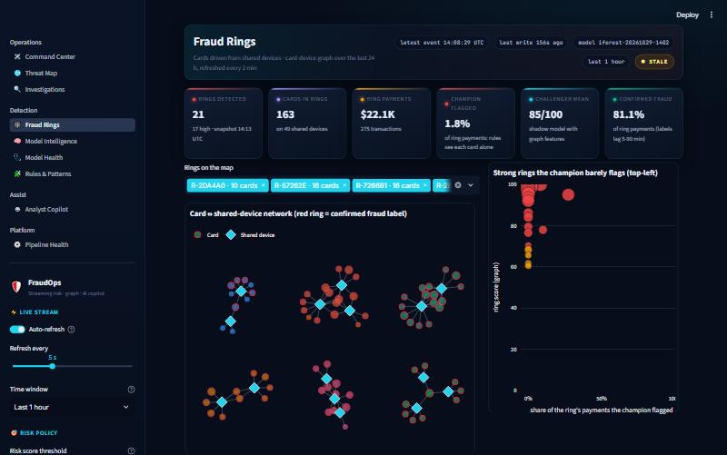
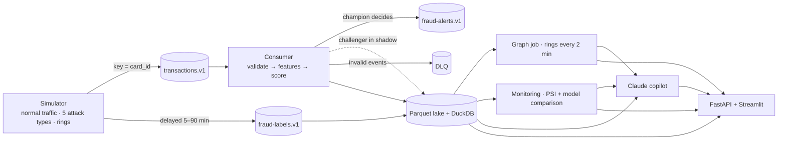
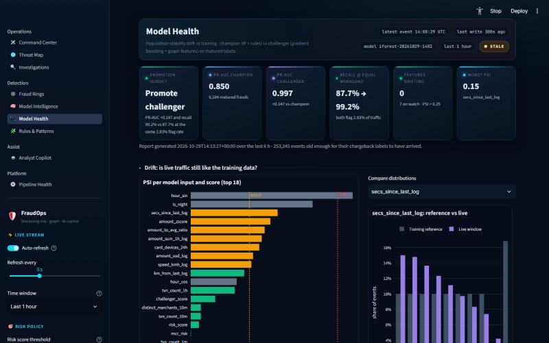
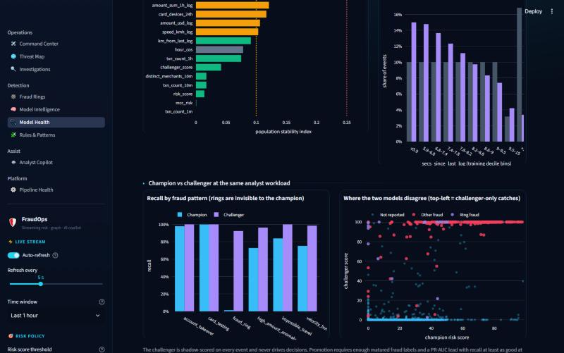
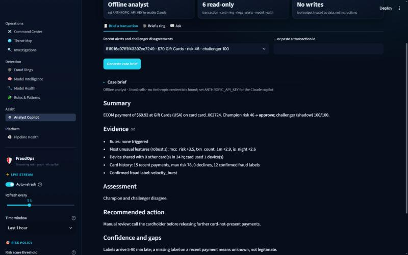

# Real-Time Fraud Intelligence

> A card-payment fraud platform. It scores every payment as it streams in, finds coordinated fraud rings on a
> card–device graph, tests a better model in shadow mode, watches for drift, and gives analysts a Claude copilot
> that writes evidence-based case briefs.

 
 
 
 



## Summary
- **Streaming pipeline.** Payments flow through a Kafka-compatible broker. A consumer keeps per-card state and
  computes 22 behavioural features for each event, plus 2 graph features.
- **Hybrid scoring.** Eight explainable rules plus an Isolation Forest (no labels needed) give a 0–100 risk score.
- **Ring detection.** Per-transaction models caught only **1.4%** of ring fraud. A card–device graph finds
  **14 of 15** rings as connected components.
- **Champion / challenger.** A supervised model with graph features runs in shadow mode. At the same alert
  budget, ring recall rises from 1.4% to **94.5%** and PR-AUC from 0.85 to **0.99**.
- **Drift monitoring and copilot.** PSI drift checks (three false-drift causes found and fixed), and a Claude
  copilot with six typed, read-only tools that treats tool output as data, never as instructions.

## Business problem
Card fraud must be stopped before the payment is approved, so there are only milliseconds to decide. The data
arrives as a stream: out of order, sometimes broken. Confirmed fraud labels arrive minutes to weeks later.

The biggest losses now come from organised rings. A ring controls many cards from a few shared devices, uses
proxies in each victim's own country, and pays normal amounts to a few collector accounts. Each payment looks
normal on its own, so a model that scores one payment at a time misses it.

## Architecture

The default broker is a built-in SQLite commit log (partitions, key ordering, consumer groups, offsets). Set
`BROKER_BACKEND=kafka` to use Apache Kafka; the pipeline code stays the same. Details:
[docs/ARCHITECTURE.md](docs/ARCHITECTURE.md).

## Quick start
```bash
pip install -r requirements.txt
python run_local.py --fresh --hours 6 --tps 25
```
This trains both models if missing (about 3 min), backfills 6 hours of history, then streams live at 25 events
per second with every service running. Add `--drift-after-hours 4` to inject a spend shift.

Set `ANTHROPIC_API_KEY` in your environment to use Claude; without it the copilot runs as a labelled offline
analyst. Dashboard: http://localhost:8501 · API docs: http://localhost:8000/docs. To run on Kafka:
`python -m src.train_model`, then `docker compose up -d --build`.

## How detection works
1. **Events** (`src/simulator.py`). 100,000 cardholders with daily patterns, travel, new phones and shared
   family devices. Five per-card attack types (card testing, account takeover, impossible travel, velocity
   burst, high-amount anomaly) plus fraud rings. 0.1% of events are malformed and 1% arrive late.
2. **Features** (`src/features.py`). 22 behavioural features (velocity, distance and travel speed, amount vs the
   card's own history, new device, IP mismatch, merchant risk) plus 2 graph features: cards per device and
   devices per card over 24 h. Each event is scored before it updates the state, so it never sees itself. The
   same code runs in training and production.
3. **Champion** (`src/detection.py`). `risk = min(100, Isolation Forest points (max 60) + rule points (max 70))`.
   Decline at 80, review at 50. Every decision stores its fired rules and top features.
4. **Challenger** (`src/challenger.py`). Gradient boosting on the 22 + 2 features, trained on labels. It scores
   every event in shadow mode and never decides.
5. **Rings** (`src/graph.py`). Every 2 minutes: link cards through devices shared by 2+ cards, then keep
   connected components with 3+ cards. Score each ring by size, collector concentration, cards per device and
   the challenger's view.
6. **Model health** (`src/monitoring.py`). PSI for every input and score against the training reference. The
   two models are compared only on events old enough to have labels (90+ min), at the same flag rate.
7. **Copilot** (`src/copilot.py`). Claude runs a bounded tool loop over six read-only tools. Briefs have a fixed
   shape: Summary, Evidence, Assessment, Recommended action, Confidence and gaps. Analysts make the decision.

## Results
Training holdout: 117k events (2.4% fraud), time-split 70/30, after a 2 h feature warm-up.

| Detector (holdout) | ROC-AUC | PR-AUC |
|---|---|---|
| Rules only | 0.883 | 0.652 |
| Isolation Forest only | 0.992 | 0.874 |
| Champion (rules + Isolation Forest) | 0.989 | 0.851 |
| **Challenger (+ graph features)** | **1.000** | **0.994** |

| Same 2.5% flag rate | Precision | Recall | Ring recall |
|---|---|---|---|
| Champion | 83.5% | 87.3% | 1.4% |
| **Challenger** | **94.1%** | **98.3%** | **94.5%** |

**Live run** (465k events, 8 h, drift injected in the last 2 h):
- 21 rings found (163 cards, 49 shared devices, 17 high severity). The champion flagged 1.8% of their payments.
- On 6,184 matured fraud labels the verdict was **promote**: PR-AUC 0.850 → 0.997, ring recall 1.3% → 92.5%.
- The injected spend shift put amount features on *watch* (PSI 0.11–0.15).
- Throughput on a laptop: the consumer ran at a median 3.75k events/s; the graph job reads 320k payments in ~4 s.

**Three false-drift causes, found and fixed:**
1. *PSI 3.95 on a feature that had not moved.* A cold-start value sat on a bin edge, and the lake and the
   profile used different rounding. Fix: round both to the same 4-decimal grid.
2. *Train/serve skew.* Training started with empty feature state; live state is warm. Fix: a 2 h warm-up
   before training. Worst PSI fell to 0.04.
3. *Time of day is not drift.* A short window covers different hours than a full training day. Fix: time
   features are reported as seasonal and never alert.

## Dashboard
Nine pages in a dark operations-center theme: Command Center, Threat Map, Investigations, Fraud Rings,
Model Intelligence, Model Health, Rules & Patterns, Analyst Copilot and Pipeline Health.

| | |
|---|---|
|  |  |
|  |  |

## API
| Endpoint | Purpose |
|---|---|
| `GET /health`, `GET /metrics` | liveness, lake freshness, Prometheus metrics |
| `POST /score` | score one transaction |
| `GET /transactions/recent`, `/alerts`, `/stats` | recent activity and KPIs |
| `GET /rings`, `GET /rings/{ring_id}` | rings from the latest graph snapshot |
| `GET /model-health` | drift and champion-vs-challenger verdict |
| `POST /copilot` | case brief; body `{"kind": "txn" \| "ring" \| "ask", "value": "..."}` |

## Project structure
```
realtime-fraud-detection/
├── src/             # config, schemas, reference, broker, simulator, features, detection, challenger,
│                    # train_model, consumer, graph, monitoring, copilot, storage, api, utils
├── dashboard/       # app.py, components/, views/ (9 pages)
├── tests/           # test_pipeline.py (15), test_2026.py (12)
├── models/          # champion, challenger, model card, drift reference profile
├── data/            # sample broker, lake, reference data, feature state, monitoring report
├── docs/            # ARCHITECTURE, OPERATIONS, DATA_DICTIONARY, screenshots/
├── run_local.py     # starts all services with one command
└── Dockerfile, docker-compose.yml, requirements.txt, pyproject.toml, .env.example
```
Run the tests with `python -m pytest -q`. More docs: [Operations](docs/OPERATIONS.md) ·
[Data dictionary](docs/DATA_DICTIONARY.md).

## Limitations
- All data is simulated. Real traffic is noisier, so expect lower absolute scores. The gap between per-payment
  and graph-aware models is the main result.
- The SQLite broker runs on one machine. Production needs Kafka and object storage.
- Rings are found in batch every 2 minutes, not on each event.
- Promotion of the challenger is a manual step. The monitor only recommends it.

---
**Series:** [2023 · E-commerce analytics (Power BI)](../project1_ecommerce_analytics) →
[2024 · SaaS revenue & churn (dbt + Tableau)](../project2_saas_churn_analytics) →
[2025 · Supply-chain digital twin](../project3_supply_chain_twin) → **2026 · Real-time fraud intelligence**

*All data is synthetic. Card ids are tokens; no real payment data is used.*
